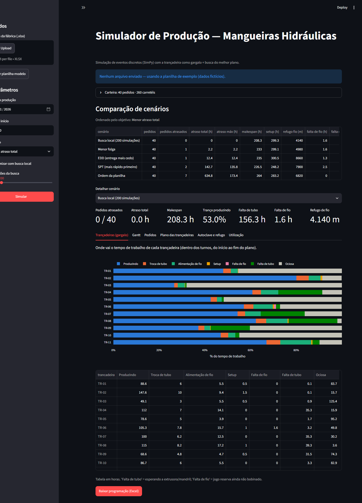
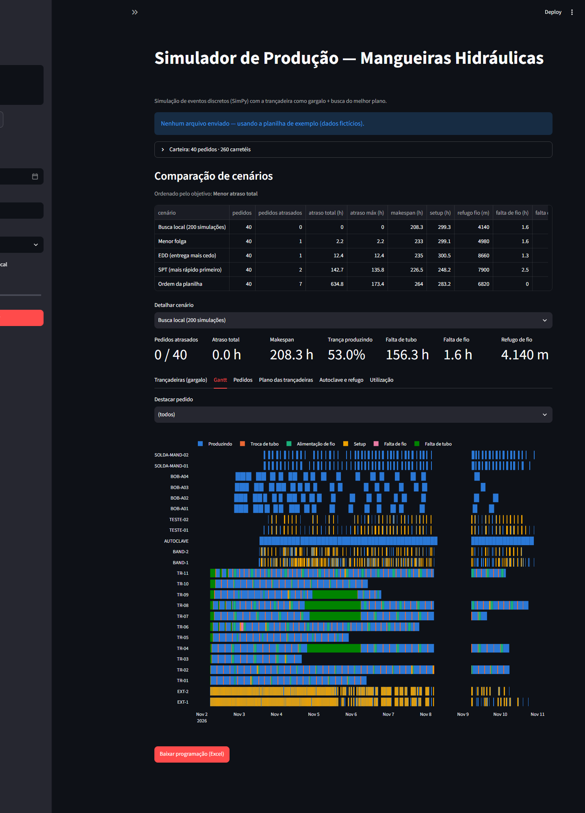

# Simulador de Produção — Mangueiras Hidráulicas

Simulador de eventos discretos (SimPy) de uma fábrica de mangueiras hidráulicas trançadas, com interface
Streamlit: o usuário envia um Excel com a carteira de pedidos e o simulador decide **em qual trançadeira,
com qual construção e em que ordem** produzir cada pedido, mostrando atrasos, perdas do gargalo e o Gantt.





## A fábrica modelada

```
mandris ─► EXTRUSÃO DO TUBO ─► pulmão ─► TRANÇADEIRA ─► cobertura ─► bandagem ─► autoclave ─► desbandagem ─► teste
   ▲                                       ▲    │                                                              │
   └─────────── inspeção/solda ◄───────────┼────┼──────────────── mandril volta ◄─────────────────────────────┘
                                   jogos   │    │  jogos
                                   cheios  │    ▼  vazios
                                         BOBINAGEM
```

Cada processo é uma **estação** independente; elas só conversam por estoques (`simpy.Store`/`Container`).

**Regras implementadas**

- **Carretel** é a unidade de fluxo; pedidos são arredondados para carretéis cheios (metros por dash).
- **Construções:** um produto pode ter várias; cada uma define fio, rendimento do jogo e tempos. O planejador escolhe.
- **Passagens:** 2 camadas numa trançadeira de 1 deck = 2 passagens (o tubo sai e volta: nova troca de tubo).
- **Jogos de bobina:** cada trançadeira tem os seus (não empresta). Quando o fio acaba, pega o jogo reserva —
  se ele ainda está na bobinagem, a trançadeira para por **falta de fio**. Alimentação: 47 min por deck em uso.
- **Troca de tipo de fio** descarta o resto do jogo montado (**refugo**).
- **Bobinagem** sabe qual fio a trançadeira vai precisar em seguida e bobina o jogo vazio com ele (uma bobinadeira por jogo).
- **Pulmão de tubos (corda):** a extrusora só faz tubo para uma trançadeira se houver vaga no pulmão dela;
  tubo tem prioridade sobre cobertura na extrusora (proteger o gargalo). Sem tubo: **falta de tubo**.
- **Mandris** em ciclo fechado por dash: voltam após a ejeção, passam pela inspeção/solda e ficam disponíveis.
- **Autoclave:** lote de até N carretéis do mesmo grupo de mistura; ciclo = maior ciclo do lote; não pausa.
- **Turnos:** o calendário de trabalho vem da aba `turnos` (ex.: seg–sáb, 3 turnos).

## Como funciona a otimização

O SimPy simula; ele não escolhe. O planejador (`src/heuristics.py`):

1. gera uma ordem de pedidos por regras clássicas (planilha, EDD, SPT, menor folga);
2. coloca cada pedido na combinação construção + trançadeira que termina mais cedo;
3. faz uma busca local (mover pedidos na fila, trocar trançadeira/construção), simulando cada tentativa.

## Estrutura

```
app.py                     interface Streamlit
src/data_loader.py         leitura e validação do Excel
src/calendario.py          turnos -> tempo de trabalho
src/simulation.py          modelo SimPy (estações: trançadeira, bobinagem, extrusão, autoclave, mandril)
src/heuristics.py          planejamento: regras, atribuição às trançadeiras e busca local
src/metrics.py             indicadores (atraso, perdas da trançadeira, refugo, utilização)
scripts/gerar_template.py  gera data/template_fabrica.xlsx (dados fictícios)
tests/                     testes (pytest) — um por regra de negócio
```

## Como rodar

```bash
python -m venv .venv
.venv\Scripts\activate          # Windows  (Linux/Mac: source .venv/bin/activate)
pip install -r requirements.txt
streamlit run app.py
```

Testes: `pip install pytest` e `pytest`.

## Roadmap

- [x] Linha principal, rotas alternativas, setups, autoclave em lote
- [x] Estações: trançadeira (jogos, alimentação, passagens, troca de tubo), bobinagem, pulmão de tubos, ciclo do mandril
- [x] Turnos e dias trabalhados
- [ ] Dados reais de tempos por construção
- [ ] Política de extrusão de tubo (campanhas por dash)
- [ ] Operadores por processo/turno
- [ ] Espiraladeiras
- [ ] Otimizador mais forte (algoritmo genético) e cenários what-if

> Os dados da planilha de exemplo são fictícios.
